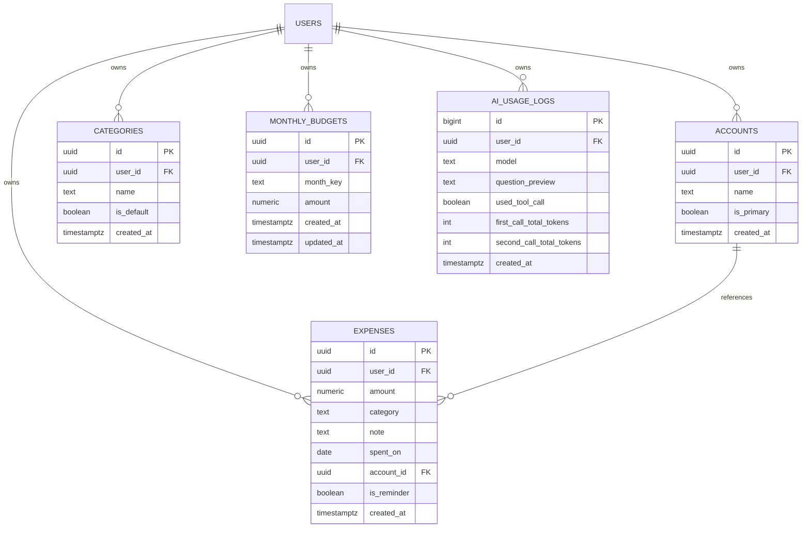

# ExpenseFlow — Project Knowledge Transfer (KT)

## 1. Project Overview & Vision

**ExpenseFlow** is a modern, cross-platform personal finance tracker and expense ledger mobile application built with **React Native (Expo)**, powered by a **Supabase (PostgreSQL + Auth + Edge Functions)** backend, and supercharged with **Google Gemini 2.5 Flash Lite** for AI-driven conversational finance querying.

### Key Value Propositions
- **Quick Ledger Entry:** Fast, minimal friction expense logging with quick-add amount increments (+100, +500), account tagging, searchable categories, and reminders.
- **Budget Tracking & Visual Progress:** Dynamic monthly budget management with automatic historical inheritance, burn-rate metrics, and warning thresholds.
- **Visual Analytics:** Breakdown charts, daily average spend calculations, ranked category distributions, and date drill-downs.
- **Conversational "Ask AI":** In-app assistant capable of answering natural language financial questions (*"How much did I spend on food this week?"*) using **Structured RAG (Tool / Function Calling)** against live PostgreSQL data.
- **Multi-Account & Multi-Category:** Support for bank accounts, credit cards, cash, system default categories, and custom user categories.
- **Offline Resilience & OTA Updates:** Local caching via AsyncStorage and background Over-The-Air JavaScript bundle updates via `expo-updates`.

---

## 2. Tech Stack

| Layer | Technology | Details |
|---|---|---|
| **Mobile Framework** | React Native 0.85.3, React 19.2.3 | Bootstrapped with Expo SDK 56 (Dev Client workflow) |
| **Language** | TypeScript 6.0 | Strict type safety across components, services, and stores |
| **Navigation** | React Navigation v7 | `@react-navigation/native-stack` + `@react-navigation/bottom-tabs` |
| **UI Library & Icons** | React Native Paper 5.15, `@expo/vector-icons` | Material Community Icons, custom paper inputs and modals |
| **Typography** | Custom Fonts (Google Sans & Playfair Display) | Loaded via `expo-font` |
| **State Management** | Zustand 5.0 | Modular stores: `authStore`, `expenseStore`, `accountStore`, `categoryStore`, `budgetStore`, `aiChatStore` |
| **Backend & Database** | Supabase | PostgreSQL with Row Level Security (RLS), Auth, RPCs |
| **Serverless Functions**| Supabase Edge Functions (Deno) | `ask-ai` function orchestrating Gemini API calls |
| **AI Model** | Google Gemini 2.5 Flash Lite | Low-temperature (0.3) tool-calling for factual financial computation |
| **Monitoring** | Sentry (`@sentry/react-native`) | Crash reporting, error handling, performance & profiling |
| **OTA Updates** | Expo Updates (`expo-updates`) | Runtime version `"1.1"` configured in `app.json` |

---

## 3. Repository & Directory Structure

```
d:/Personal/ExpenseFlow/
├── assets/                          # App icons, splash screens, and GoogleSans/Playfair TTF fonts
├── docs/                            # HTML pages (Privacy Policy, Delete Account) & reference SQL
├── supabase/
│   ├── config.toml                  # Supabase CLI configuration
│   ├── functions/
│   │   └── ask-ai/                  # Deno Edge Function for the "Ask AI" chatbot
│   │       ├── index.ts             # Function entry point, auth verification, token quotas & Gemini loop
│   │       ├── prompt.ts            # System instructions and dynamic fiscal calendar context
│   │       └── tools.ts             # Gemini tool definitions and SQL query executors
│   └── migrations/                  # Schema migrations:
│       ├── 202604230001_create_ai_usage_logs.sql
│       ├── 202607120001_create_accounts_table.sql
│       ├── 202607270001_add_is_reminder_to_expenses.sql
│       └── 202610130001_create_monthly_budgets_table.sql
├── src/
│   ├── components/                  # Reusable UI components
│   │   ├── AnalyticsView.tsx        # Spending charts, category bars, and day breakdowns
│   │   ├── AutocompleteInput.tsx    # Searchable dropdown input
│   │   ├── Button.tsx               # Styled primary / secondary button
│   │   ├── Card.tsx                 # Base container card
│   │   ├── ExpenseItem.tsx          # Expense transaction row with swipe/tap actions
│   │   └── Input.tsx                # Base text input
│   ├── config/
│   │   └── env.ts                   # Supabase URL/Anon key, AI quota config
│   ├── navigation/
│   │   └── AppNavigator.tsx         # Root Stack Navigator + Bottom Tab Navigator
│   ├── screens/                     # Application screens
│   │   ├── AddExpenseScreen.tsx     # Full modal expense creation/edit screen
│   │   ├── AiUsageScreen.tsx        # Token consumption and cost breakdown screen
│   │   ├── AnalyticsScreen.tsx      # Analytics entry screen wrapper
│   │   ├── AskAiScreen.tsx          # Natural language AI chat screen
│   │   ├── AuthScreen.tsx           # Authentication stack wrapper
│   │   ├── ForgotPasswordScreen.tsx # Email reset request screen
│   │   ├── HomeScreen.tsx           # "Add" bottom-tab quick entry ledger screen
│   │   ├── LoginScreen.tsx          # User login screen
│   │   ├── ManageAccountsScreen.tsx # Manage payment methods (Bank, Cash, etc.)
│   │   ├── ManageCategoriesScreen.tsx # Manage custom expense categories
│   │   ├── MonthlyScreen.tsx        # Monthly overview view
│   │   ├── OverviewScreen.tsx       # Primary dashboard (Timeline + Analytics tabs)
│   │   ├── ReminderScreen.tsx       # Reminder / recurring expense tracker
│   │   ├── ResetPasswordScreen.tsx  # Deep link target for resetting password
│   │   ├── SettingsScreen.tsx       # Profile, management shortcuts, and account deletion
│   │   └── SignupScreen.tsx         # User registration screen
│   ├── services/                    # API and database layer
│   │   ├── accountService.ts        # Accounts CRUD operations
│   │   ├── aiService.ts             # Invokes Supabase 'ask-ai' Edge Function
│   │   ├── aiUsageService.ts        # Fetches usage stats from ai_usage_logs
│   │   ├── budgetService.ts         # Monthly budget resolution, persistence, and fallback logic
│   │   ├── categoryService.ts       # Category CRUD operations
│   │   ├── expenseService.ts        # Expense transactions CRUD operations
│   │   ├── supabase.ts              # Supabase JS client initialization with AsyncStorage
│   │   └── updateService.ts         # Checks and applies EAS / Expo OTA updates
│   ├── store/                       # Zustand state management
│   │   ├── accountStore.ts          # Accounts state and primary account resolver
│   │   ├── aiChatStore.ts           # In-memory chat message state
│   │   ├── authStore.ts             # Session, user metadata, and password reset flag
│   │   ├── budgetStore.ts           # Monthly budget targets state
│   │   ├── categoryStore.ts         # User + default categories state
│   │   └── expenseStore.ts          # Daily, monthly, and reminder transactions state
│   ├── theme/
│   │   └── theme.ts                 # Palette, typography, spacing, border radiuses
│   ├── types/
│   │   ├── env.d.ts                 # Environment variable type declarations
│   │   └── index.ts                 # Shared data models (Expense, Account, Budget, etc.)
│   └── utils/
│       └── dateUtils.ts             # Date formatting and comparison utilities
├── App.tsx                          # App root (Font loader, Sentry wrap, Deep link handler)
├── app.json                         # Expo configuration (bundle ID, scheme, OTA URL)
├── eas.json                         # Expo Application Services build profiles
├── package.json                     # Node dependencies and scripts
└── tsconfig.json                    # TypeScript compiler options
```

---

## 4. Database Schema & Architecture

Every table is secured by **PostgreSQL Row Level Security (RLS)** using `auth.uid() = user_id`.



### Table Details
1. **`expenses`:**
   - Stores transactions with `spent_on` formatted as ISO `'YYYY-MM-DD'`.
   - Supports marking transactions as reminders via `is_reminder = true`.
   - Links to optional payment source `account_id` with `ON DELETE SET NULL`.
2. **`accounts`:**
   - User-defined accounts (e.g., "HDFC Bank", "Cash", "Amex Card").
   - Enforces unique name per user: `UNIQUE(user_id, name)`.
   - Tracks a primary default account via `is_primary`.
3. **`categories`:**
   - Default system categories have `user_id IS NULL` and `is_default = true` (`Food & Dining`, `Travel & Transport`, `Shopping`, `Bills & Utilities`, `Entertainment`, `Other`).
   - Custom user categories have `user_id = auth.uid()` and `is_default = false`.
4. **`monthly_budgets`:**
   - Spending cap for a specific month identified by `month_key` (format: `'YYYY-MM'`).
   - Unique constraint: `UNIQUE (user_id, month_key)`.
5. **`ai_usage_logs`:**
   - Captures prompt, candidate, and total token usage per request.
   - Enables in-app visibility of daily quotas and estimated API cost.

---

## 5. Core Application Modules

### 1. Authentication & Deep Link Routing
- **Session Lifecycle:** `useAuthStore` monitors auth state changes using Supabase's `onAuthStateChange`.
- **Password Recovery Flow:**
  - Password reset emails trigger deep links back into the app using custom scheme `expenseflow://`.
  - `App.tsx` intercepts cold start and background deep links, parses the `#access_token` and `type=recovery` fragment, sets the Supabase session, and flags `pendingPasswordReset: true`.
  - `AppNavigator.tsx` conditionally routes the user directly to `ResetPasswordScreen`.

### 2. Dashboard & Overview (`OverviewScreen.tsx`)
- **Top Toggle Tabs:**
  - **Timeline:** Date-grouped transaction cards, expandable details, inline delete/edit actions, monthly budget progress bar, and active reminders.
  - **Analytics:** Powered by `AnalyticsView.tsx`:
    - Daily Average Spending vs Budget Burn Rate.
    - Category percentage bar charts with ranked visual color coding.
    - Daily expense breakdown list with one-tap drill-down to highlight specific dates in the timeline.
- **Month/Year Picker:** Custom modal allowing switching across any historical or future fiscal month.

### 3. Quick Ledger Entry (`HomeScreen.tsx` & `AddExpenseScreen.tsx`)
- **HomeScreen (Bottom Tab "Add"):** Streamlined quick-entry ledger form. Includes quick +100 / +500 increment pills, account picker, category selector with live search, date picker, notes, and reminder toggle.
- **AddExpenseScreen (Modal):** Full-screen modal accessible from the timeline for both adding and editing existing transactions.

### 4. Smart Budget Inheritance Logic (`budgetService.ts`)
When resolving a budget for a given month (`YYYY-MM`):
1. **Exact Match:** Returns the custom budget configured for that specific month.
2. **Inherited Budget:** If not set, finds the latest budget configured in any month **prior** to the requested month.
3. **Earliest Recorded:** If the requested month is before any recorded budget, uses the earliest known budget.
4. **Fallback Default:** If no budget has ever been recorded by the user, defaults to **₹20,000** (`DEFAULT_BUDGET`).
- Syncs with Supabase database and persists locally in AsyncStorage for instant offline access.

### 5. Ask AI Conversational Assistant (`AskAiScreen.tsx` & `ask-ai`)
- Implements **Structured RAG (Tool Calling)** instead of standard semantic vector search to guarantee accurate math on tabular records:
  ```mermaid
  sequenceDiagram
      actor User
      participant RN as React Native App
      participant EF as Supabase Edge Function
      participant Gemini as Gemini 2.5 Flash Lite
      participant DB as PostgreSQL (RLS)

      User->>RN: Types "How much did I spend on food this month?"
      RN->>EF: supabase.functions.invoke('ask-ai', { message, history })
      EF->>Gemini: Prompt + Message + Tools definitions
      Gemini-->>EF: Tool call: get_spending_summary(category='Food', startDate=...)
      EF->>DB: Query filtered expenses using user's RLS token
      DB-->>EF: Exact financial rows/totals
      EF->>Gemini: Return tool execution results
      Gemini-->>EF: Formatted natural language response
      EF->>DB: Log token usage to ai_usage_logs
      EF-->>RN: { reply: "You spent ₹4,250 on Food this month." }
      RN-->>User: Renders chat bubble
  ```
- **Gemini Tools Declared:**
  - `get_expenses(startDate, endDate, category, accountId)`
  - `get_spending_summary(startDate, endDate)`
  - `get_expense_stats()`
- **Safety & Guardrails:** Low temperature (`0.3`), max 10 message history window, message character limit (500 chars), and per-user daily token quota checking.

### 6. Store Synchronization & Cache Versioning (`expenseStore.ts`)
- Utilizes a version-based cache synchronization pattern (`newEntryVersion` and `monthlySyncedEntryVersion`).
- When a user inserts, edits, or deletes an expense, `newEntryVersion` increments.
- When navigating back to the Overview or Analytics screens, `useFocusEffect` checks if the screen's synced version is behind `newEntryVersion`. If so, it silently refreshes the dataset without unnecessary re-fetching.

---

## 6. Development & Deployment Guide

### Local Development Workflow
```powershell
# 1. Install dependencies
yarn install

# 2. Start Metro bundler
npm run start

# 3. Connect device via ADB over Wi-Fi
adb pair 192.168.x.x:<pair-port>
adb connect 192.168.x.x:<connect-port>
adb devices

# 4. Run Android build
npm run android
```

### Supabase Edge Function Deployment
```powershell
# 1. Link to Supabase project
supabase link --project-ref plzpvzvefrwumyqrtlty

# 2. Configure Gemini API secret
supabase secrets set GEMINI_API_KEY=AIzaSy...your-key-here

# 3. Deploy function
supabase functions deploy ask-ai
```

### Publishing Over-The-Air (OTA) Updates
Updates can be pushed instantly to devices without going through app store reviews as long as native dependencies have not changed:
```powershell
eas update --branch production --message "Describe updates"
```

### Production Release Build (Android)
```powershell
# Generate signed Android App Bundle (.aab)
cd android
./gradlew bundleRelease
# Output located at: android/app/build/outputs/bundle/release/app-release.aab
```

---

## 7. Important Caveats & Best Practices

1. **Row Level Security (RLS):** All queries must execute in an authenticated context (`supabase.auth.getUser()`). Never bypass RLS or use the Supabase `service_role` key inside client code.
2. **API Keys:** The `GEMINI_API_KEY` is strictly stored as a Supabase Edge Function secret and is **never** bundled into the mobile app's `.env` or client JS bundle.
3. **Runtime Versioning:** OTA updates are locked to the runtime version (`"1.1"` in `app.json`). If native dependencies or gradle configurations change, bump the `version` and `runtimeVersion` to prevent crashing older binaries.
4. **Fiscal Calculations:** Date utilities in `dateUtils.ts` account for financial year boundaries (April 1 to March 31) when presenting fiscal ledger information.
